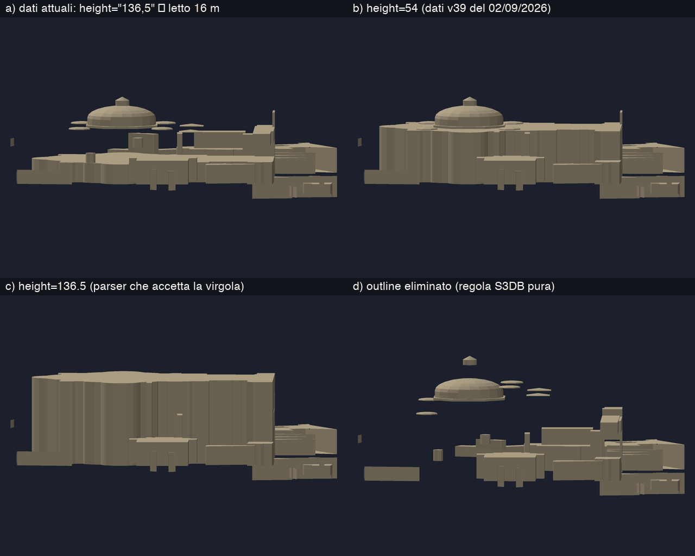
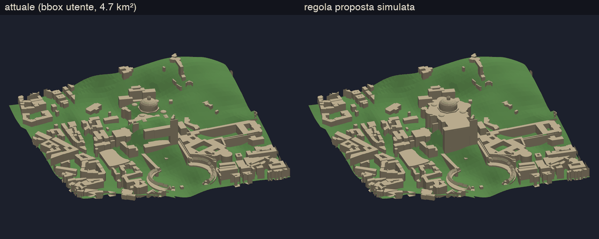
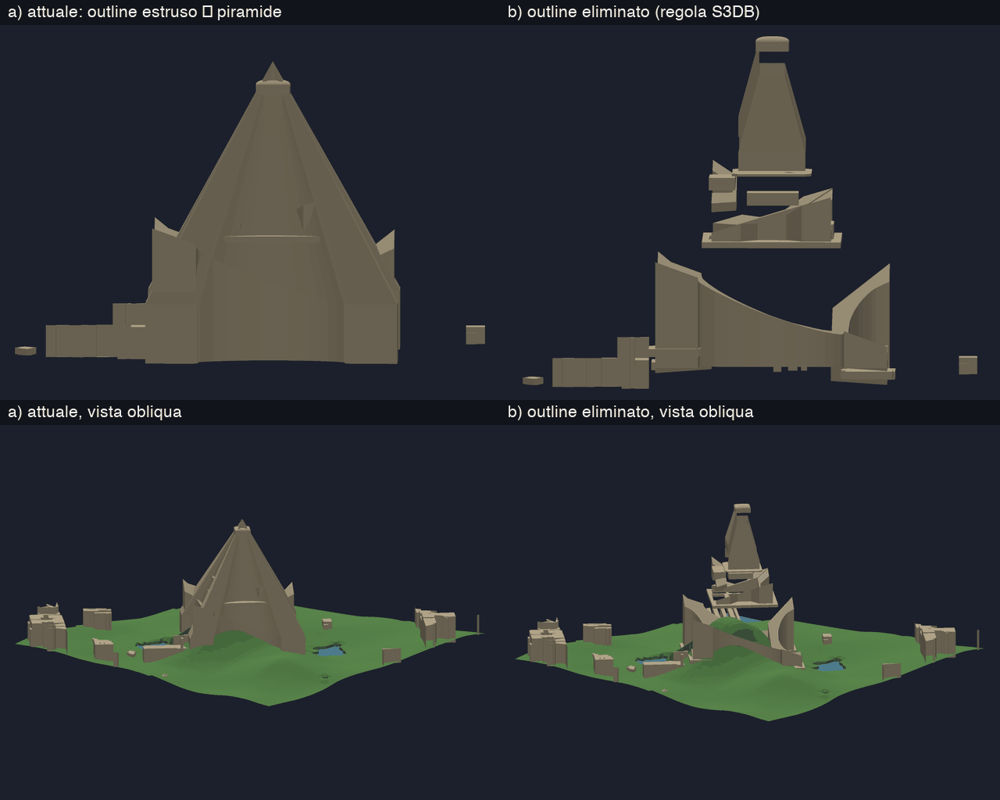
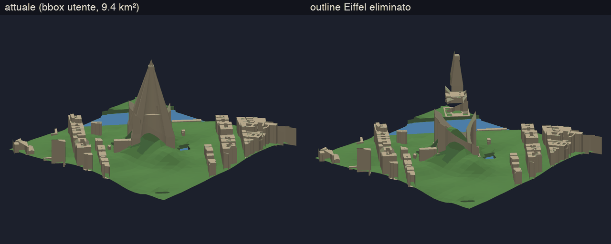
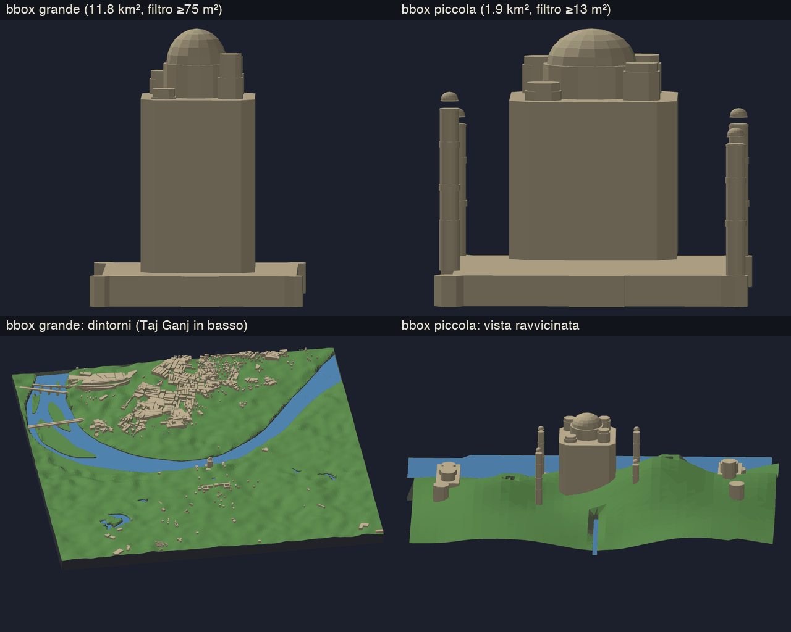
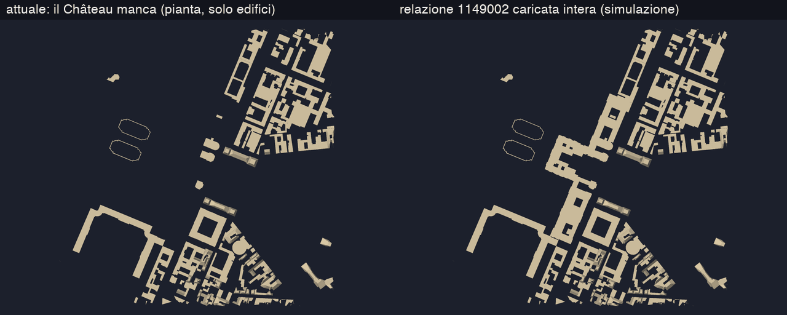
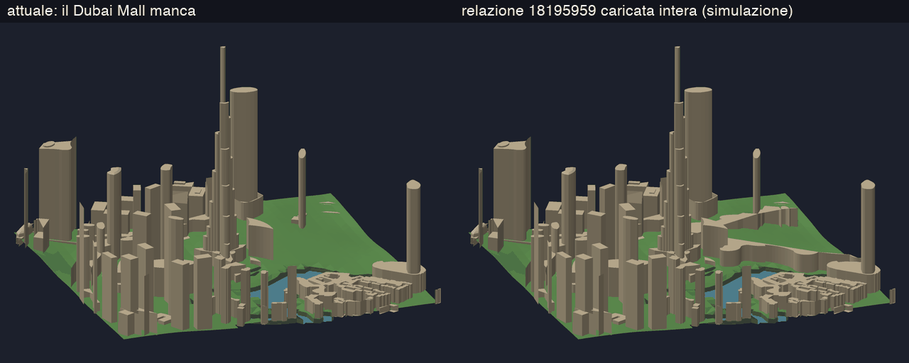
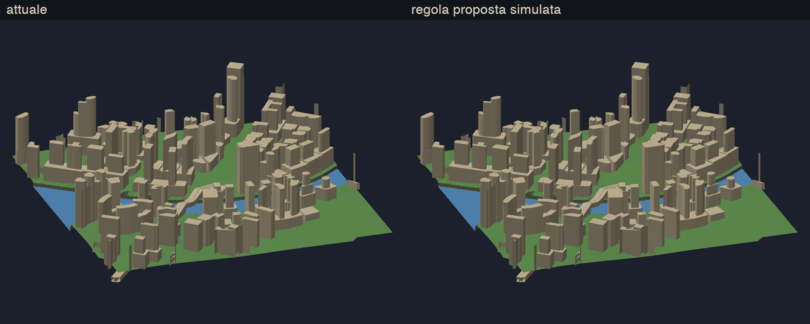

# Landmark sbagliati: algoritmo o dati?

Analisi dei casi in `concepts/`:
- **San Pietro** e **Taj Mahal**: mancano parti;
- **Torre Eiffel**: architettura sbagliata.

Durante la ricerca sono emersi altri difetti, non segnalati: il Château de Versailles e il Dubai Mall spariscono del tutto.

Tutte le prove sono **riproducibili** con la sezione di test ([README](README.md)):
- gli snapshot dei dati OSM sono stati registrati il **12/10/2026 tra le 21:09 e le 21:13 UTC**;
- il codice della pipeline è quello di `d23cd49`, con comportamento invariato;
- gli esperimenti modificano solo i **dati** prima del parsing, mai l'algoritmo.

Le conclusioni valgono per i dati OSM di quella data.

**Classi usate per ogni elemento:**
- **(a)** dato assente in OSM;
- **(b)** dato presente ma taggato male o non letto;
- **(c)** regola dell'algoritmo sbagliata;
- **(d)** scartato *correttamente* perché sotto la risoluzione di stampa.

## Verdetto per elemento

| # | Elemento | Sintomo | Classe | Causa | Prova |
|---|---|---|---|---|---|
| 1 | San Pietro: cupola, tamburo, attico | sospesi 26–32 m sopra una navata di 16 m | **(b) + (c)** | modifica OSM del 22/09/2026 (`height="136,5"`, con la virgola) non letta → `building:levels=5` = 16 m; la regola outline/part non regge comunque i dati S3DB incompleti | esperimenti §2 (4 varianti dei dati) |
| 2 | Torre Eiffel | piramide piena alta 139 m | **(c)** | outline estruso perché le part coprono a terra il 25% (< 55%), anche se l'unione delle part copre il 100%; inoltre `roof:direction` è ignorato e le part `roof` ricevono pareti | §3, outline eliminato |
| 3 | Taj Mahal: minareti | spariti nella bbox grande | **(d)** | ogni livello dei minareti è una relazione con 4 anelli da ~32 m²; il filtro (≥75 m²) lavora per anello; 32 m² = 0.29 mm stampati | §4.2, bbox piccola contro grande |
| 4 | Taj Mahal: proporzioni | cupola schiacciata su un corpo-scatola | **(c)** | soft-knee a 29 m: tutto ciò che sta sopra è compresso a 0.3× (cupola/corpo da 2.0 a 1.3) | §4.3 |
| 5 | Taj Ganj (quartiere) | quasi vuoto | **(a)** | OSM ha lo **0.9%** degli edifici che Google/Microsoft rilevano (24 contro 2 662) | §4.1, Overture Maps |
| 6 | Château de Versailles, Grand Trianon | **assenti** | **(c)** | relazione multipolygon a cavallo di due tile: l'API diretta OSM restituisce solo i membri del tile e le copie incomplete vengono scartate; per gli edifici non c'è ricaricamento (per l'acqua sì) | §5.1, relazione iniettata intera |
| 7 | Dubai Mall (248 182 m²) | **assente** | **(c)** | la prima copia, incompleta, viene scartata e la copia completa del tile successivo è ignorata (dedupe per id) | §5.1 |
| 8 | Palais de Chaillot | 7 454 m² mancanti | **(c)** | come il 7 | §5.1 |
| 9 | Arc de Triomphe | blocco pieno, archi chiusi | **(c)** | stessa regola della Eiffel (terra 45%, unione 85%) | audit §3 |
| 10 | Dubai: 8 torri su podio | podio estruso all'altezza della torre | **(c)** | outline con l'altezza **totale** (S3DB) estruso su tutto il podio | §5.3 |
| 11 | Barcellona: isolati dell'Eixample | volumi bassi interni nascosti | **(c)** | 1 187 outline estrusi all'altezza massima sopra le proprie part | §5.2 |
| 12 | Dubai: skyline | 470 edifici compressi | **(c)** di design | knee = 3 × mediana (8.8 m, dominata da altezze di default) | §4.3 |

**In sintesi:**
- **Taj Ganj** è l'unico caso puramente di **dati**.
- La **Torre Eiffel** è puramente di **algoritmo**: i dati sono completi e corretti secondo la specifica.
- **San Pietro** è un difetto latente dell'algoritmo, fatto emergere da una modifica dei dati.
- Spariscono anche edifici interi (Versailles, Dubai Mall), per un difetto dell'algoritmo che **dipende dalla sorgente**: Overpass o API diretta, in base a quale mirror risponde. Le render dell'utente ne erano già influenzate.

---

## 1. Metodo

1. **Harness** (`tests/cities/`): stessa pipeline del server, estratta in `api::handlers::generate`. Il refactor è verificato equivalente: il server di riferimento (`d23cd49`) e il codice nuovo danno la **stessa mesh triangolo per triangolo** sulla stessa richiesta e sorgente.
2. **Snapshot** dei corpi HTTP OSM e della griglia DEM. Il replay è deterministico: 8/9 luoghi sono identici bit per bit, Dubai differisce di ±1 ULP nei ponti (§5.5).
3. **Esperimenti sui dati**: patch ai tag (o rimozione di elementi) e iniezione di relazioni intere, rigiocati con la pipeline invariata.
4. **Audit** (`analysis/audit.py`) sui dati grezzi di tutti i 9 luoghi. Replica il parsing Rust (`parse_meters`, filtro impronte, soppressione degli outline, assemblaggio degli anelli) e prototipa la regola proposta con shapely.
5. **Riferimento esterno**: Overture Maps (release `2026-09-23.1`), che unisce OSM con le impronte ML di Google Open Buildings e Microsoft.
6. **Metrica "solidi sospesi"** nel manifest: elementi con `min_height` ≥ 0.5 m senza niente sotto il baricentro che arrivi alla loro base. È un'euristica: utile per confrontare le run, non una prova geometrica.

Specifica di riferimento: [Simple 3D Buildings](https://wiki.openstreetmap.org/wiki/Simple_3D_Buildings), letta il 12/10/2026:
- *"When a building has any building:part=\* areas, the building outline is not considered for 3D rendering."*
- *"The entire building outline should be filled with building:part=\* areas."*
- `height` sull'outline è l'altezza **totale** fino al tetto più alto.

[`roof:direction`](https://wiki.openstreetmap.org/wiki/Key:roof:direction) è *"the direction of the roof slope… from high (ridge) to low (eaves)"*. Non ho verificato come si comportano i singoli renderer (F4map, OSM2World, Streets GL): le affermazioni sopra vengono solo dalla specifica.

---

## 2. San Pietro — modifica OSM + regola fragile

**Dati.** La cronologia dell'outline `way/244159210` (`building=basilica`) è questa:

| versione | data | `height` | `building:levels` |
|---|---|---|---|
| v22–v39 | 10/01/2025 → 02/09/2026 | `54` | 5 |
| **v40** | **22/09/2026** | **`136,5`** | 5 |

Nel giugno 2026 San Pietro era stato verificato corretto (cupola, tamburo e lanterna) con `height=54`.

`136,5` è corretto *nel significato* (l'altezza totale secondo S3DB), ma usa la virgola. `parse_meters` (`services/osm.rs`) non la legge e ricade su `building:levels=5` × 3.2 = **16 m**.

Le 23 `building:part` dentro l'outline descrivono solo le parti alte:
- attico 30–47 m;
- piramidi 47–54 m;
- tamburo 54–60 m;
- cupola 60–110 m;
- lanterna 110–134 m;
- colonne da 1 m² tra 0.2 e 30 m, eliminate dal filtro.

La navata (0–47 m) **non è mappata come part**: coprono il suolo solo lo 0.5% dell'outline e l'unione delle part solo il 33%. È una violazione della regola S3DB "l'outline va riempito di part".

**Esperimenti** (`rome_st_peter`, stessi dati salvo una patch):



| variante | dati | risultato | solidi sospesi (>1 mm) |
|---|---|---|---|
| a | attuali `"136,5"` → 16 m | cupola e tamburo sospesi 25.7 m (4.2 mm stampati) | 39 (23) |
| b | `height=54` (v39) | corretto, come a giugno | 30 (14) |
| c | `136.5` (parser che accetta la virgola) | un blocco di 136.5 m (66 m dopo il knee) **inghiotte la cupola** | 30 (14) |
| d | outline eliminato (S3DB pura) | navata sparita, tutto sospeso | 40 (24) |

Sulla bbox dell'utente (`rome`, 4.7 km²) il difetto è lo stesso: tamburo sospeso di 31.6 m (4.2 mm).



**Verdetto.** Il problema è stato **scatenato dai dati** (b), ma la causa di fondo è l'**algoritmo** (c), perché nessuna lettura "corretta" dei dati attuali dà un buon risultato:
- con la virgola letta, c inghiotte tutto;
- applicando la specifica alla lettera, d perde la navata.

Corretto solo il parser, il risultato peggiora. L'audit mostra che la virgola è un caso raro: sui 33 348 valori di altezza e piani dei 9 luoghi, solo **2** non sono leggibili (`136,5` e `2,2` a Parigi). Ma qui colpisce l'edificio più famoso della scena.

**Correzione proposta** (P2): regola outline/part v2 (§6), insieme al parser con la virgola. Per San Pietro il prototipo dà "plinto a 54 m", che coincide con la variante b.

---

## 3. Torre Eiffel — regola sbagliata, dati completi

**Dati.** L'outline `way/5013364`:
- tag `building=tower`, `building:part=no`, `height=330`, `roof:shape=pyramidal`, `roof:height=330`;
- una nota del mapper: *"no areas of this need to be visibly rendered in 3d except those covered by the other detailed building:parts"*.

Le 25 part descrivono tutta la torre:
- 4 pilastri 0–4 m;
- 4 gambe `building:part=roof` skillion 4–57.6 m con `roof:direction` 44/134/224/314;
- primo piano 57.6–60.6 m;
- gambe superiori 57.6–115.7 m;
- secondo piano 115.7–120 m;
- fusto 115.7–276.1 m;
- terzo piano 276.1–300 m;
- antenna 300–330 m (9 m², scartata dal filtro).

Le part a terra coprono il **25.3%** dell'outline; **l'unione di tutte le part ne copre il 100%**.

**Cosa fa la pipeline.** `suppress_covered_outlines` nasconde l'outline solo se le part *a terra* coprono almeno il 55%: qui coprono il 25%, quindi l'outline resta. Viene estruso come piramide: `height` 330 → 139 m dopo il knee, `roof:height` limitato all'80% (`mesh.rs`). Il risultato è un solido di 9 755 m² di base che **nasconde tutte le part**. È esattamente la piramide di `concepts/Paris_2.png`.



Con l'outline eliminato, cioè simulando la regola S3DB, compaiono pilastri, gambe e piani, con gli archi aperti. Restano però due difetti dell'algoritmo:
- **`roof:direction` ignorato**: `skillion_heights` mette il lato basso sul lato più lungo dell'impronta. Le gambe dovrebbero salire verso il centro (lato basso verso SW, SE, NE e NW), invece le pendenze sono casuali.
- **`building:part=roof`**, cioè solo tetto, riceve pareti: il limite all'80% lascia sempre almeno il 20% di parete verticale.

Di conseguenza i piani restano scollegati e i solidi sospesi passano da 4 a 16 (8 sopra 1 mm). Sulla bbox dell'utente (`paris`) il quadro è lo stesso:



**Verdetto: (c), solo algoritmo.** Lo stesso meccanismo rende pieno l'**Arc de Triomphe** (terra 45%, unione 85%).

**Correzioni proposte**:
- P2: regola outline/part;
- P3: `roof:direction` e part `roof` senza pareti.

---

## 4. Taj Mahal — dati mancanti, filtro e knee

### 4.1 Taj Ganj vuoto: dati (a)

| area | edifici OSM / km² | copertura | quota OSM su Overture |
|---|---|---|---|
| `taj_mahal` (11.8 km²) | 74 | 6.4% | **9.1%**: OSM 876, Google 6 317, Microsoft 2 417 |
| Taj Ganj (campione 0.66 km²) | 36 | 0.8% | **0.9%**: OSM 24, Google 2 070, Microsoft 592 |
| `rome` | 722 | 37.9% | 98.7% |
| `versailles` | 515 | 12.8% | 94.8% |
| `paris` | 982 | 38.2% | n.d. |

Nella bbox del Taj, 121 celle su 169 da 250 m hanno meno del 2% di superficie edificata. In Europa OSM coincide quasi con Overture; ad Agra contiene un edificio su undici. Quello che manca nelle render è **assente dalla sorgente**: non esiste regola dell'algoritmo che possa ricostruirlo.

Delle impronte ML, 2 655 superano il filtro di stampa di quella bbox (75 m²), contro le 672 di OSM. Usarle quadruplicherebbe gli edifici stampati. Non hanno altezze, quindi passerebbero dall'inferenza delle altezze (P7).

### 4.2 Minareti: scartati correttamente, ma un landmark perde un elemento chiave (d)

I minareti sono mappati come **una relazione per livello, con 4 anelli** (uno per minareto): fusto 5–32 m, ballatoi, chhatri. Ogni anello misura ~32 m², cioè ~6 m di diametro.

`push_building` applica il filtro di stampa **per anello**:
- bbox grande (0.0515 mm/m): soglia 75 m² → tutti e 4 i minareti spariscono (larghezza stampata 0.29 mm, sotto un ugello da 0.4 mm);
- close-up (0.1214 mm/m): soglia 13 m² → ci sono (0.70 mm).



**Verdetto (d).** Il filtro fa quello per cui è stato progettato. Visivamente però si perde un elemento caratteristico del landmark. Se preferire la fedeltà o la stampabilità è una scelta da fare (P4).

### 4.3 Proporzioni: knee (c, di design)

Il knee vale 3 × la mediana delle altezze degli outline: **29.3 m** nella bbox grande, 23.9 m nel close-up. Tutto ciò che sta sopra viene compresso a 0.3×:
- la cupola passa da 60 a 38.5 m;
- il corpo da 30 a 29.5 m.

Il rapporto altezza totale / corpo scende da **2.0 a 1.3**: il Taj diventa una scatola alta con un cappello piccolo. A Dubai lo stesso knee (mediana 8.8 m, dominata da 1 277 altezze di default) comprime **470 edifici**, e il Burj Khalifa passa da 710 a 231 m. Il knee era stato introdotto apposta per i landmark isolati; il problema è che comprime le **proporzioni interne** di un landmark composto da più part (P5).

---

## 5. Altri difetti emersi

### 5.1 Relazioni-edificio incomplete: edifici interi spariti (c)

**Meccanismo:**
1. L'API diretta OSM (`map.json`) restituisce di una relazione solo i membri che stanno nel tile. Overpass `out geom` invece restituisce sempre la geometria completa.
2. Il parser marca l'id come visto alla **prima** copia, anche se incompleta, e scarta gli anelli aperti.
3. Per l'acqua questo è stato corretto in `7678459` (gate strict + ricaricamento intero). **Per gli edifici no.**

| luogo | relazioni con prima copia incompleta | copia completa oscurata | mai complete | **edifici persi del tutto** |
|---|---|---|---|---|
| rome | 29 | 2 | 27 | 5 (Pantheon sul bordo, Valle Aurelia, …) |
| paris | 15 | 9 | 6 | 1 (Dalle de Beaugrenelle) + Palais de Chaillot parziale (−7 454 m²) |
| barcelona | 23 | 7 | 16 | 1 |
| versailles | 4 | 1 | 3 | **2: Château de Versailles, Grand Trianon** |
| dubai | 2 | 1 | 1 | **1: Dubai Mall (248 182 m²)** |

In totale 10 edifici persi del tutto. Altre 68 relazioni perdono cortili o pezzi.

Simulazione della correzione: la relazione scaricata intera (`relation/{id}/full.json`) viene iniettata nel replay.




**Il risultato dipende dalla sorgente**, quindi la stessa bbox può dare modelli diversi a seconda di quale mirror risponde (le render dell'utente sono uscite in condizioni simili):
- Nella prima registrazione (20:37 UTC), 2 tile su 4 di Versailles arrivavano da Overpass: la copia completa del castello esisteva, ma veniva **oscurata** da quella incompleta dell'API diretta analizzata prima.
- In quella delle 21:12 UTC tutti i tile vengono dall'API diretta e **non esiste alcuna copia completa**.

### 5.2 Outline estrusi sopra le proprie part (c)

Esempi: 1 187 outline a Barcellona, 44 a Parigi, 19 a Dubai. Sono outline con part ma copertura sotto il 55%, estrusi all'altezza massima delle part. A Barcellona, dove le part derivano dal catasto, l'outline prende i piani massimi (mediana della copertura delle part: 15%). Così i volumi bassi interni agli isolati dell'Eixample, a 1–2 piani, finiscono dentro un blocco a tutta altezza. È dettaglio perso, non un errore grossolano. La regola v2 non lo risolve: servirebbe estrudere il **resto** dell'outline (outline meno l'unione delle part, P6).

### 5.3 Dubai: torri su podio (c)

8 torri hanno un outline con l'altezza totale (per esempio Immersive Tower, 180 m) e una sola part per la torre, da 16 m in su. Oggi l'intero podio (fino a 4 435 m²) viene estruso a 180 m. La regola v2 lo trasforma in un podio di 16 m con la torre sopra. Un caso (`way/1041684723`, 13 563 m² a 264 m) richiederebbe invece un plinto di 195 m: per questo la regola lo segna **"da verificare"** invece di decidere.



### 5.4 Le sorgenti non sono equivalenti

- Close-up Eiffel: API diretta e Overpass producono **gli stessi 369 edifici**. Overpass però include le way che attraversano la bbox senza avere nodi dentro: 2 viadotti della Métro 6 compaiono come ponti solo via Overpass.
- Il 12/10 i mirror Overpass falliscono spesso. `rome_st_peter` in modalità solo-Overpass resta **parziale** (194 elementi su 666, dopo 142 s). Il fetch normale compensa con l'API diretta, ma così cambia il mix di sorgenti tra una run e l'altra, e con esso il §5.1.

### 5.5 Non-determinismo nei ponti

Tre replay di Dubai danno tre STL diversi: 2 624 triangoli, solo nel range dei ponti, si spostano di al massimo 4.8·10⁻⁷ mm. È probabilmente l'ordine di iterazione delle `HashMap` in `utils/bridges.rs`. È innocuo per la stampa, ma impedisce il confronto bit per bit (vedi `compare_runs.py`).

### 5.6 Acqua (osservazione, non analizzata)

Vasche e stagni di Versailles e Barcellona compaiono come crateri con bordi seghettati. È fuori dallo scopo di questa analisi.

---

## 6. Correzioni proposte (non implementate), in ordine di priorità

| | proposta | risolve | rischio e limiti, dai test |
|---|---|---|---|
| **P1** | gate strict + ricaricamento intero (`relation/{id}/full`) anche per le relazioni-edificio, come per l'acqua | 6, 7, 8 (+ cortili persi) | basso: il meccanismo esiste già. Costo: 1 richiesta per relazione incompleta (≤ 30 per luogo nei test) |
| **P2** | regola outline/part v2 + parser con la virgola **insieme** | 1, 2, 9, 10 | simulata su tutti i luoghi: cambiano 2 outline a Roma, 1 a Parigi, 8 a Dubai, 1 a Barcellona, 0 a Versailles e Taj. Limiti: Braccio di Costantino diventa una lastra 15–17 m in parte sospesa; Arc de Triomphe e `way/1041684723` restano "da verificare"; la Eiffel richiede anche P3 |
| **P3** | `roof:direction` per skillion (dal colmo alla gronda) + `building:part=roof` senza pareti | 2 | da validare sulle gambe della Eiffel (solidi sospesi 16 → ?) |
| **P4** | part alte e sottili: allargarle alla larghezza minima stampabile invece di scartarle | 3 | scelta di prodotto (fedeltà contro stampabilità); da decidere |
| **P5** | knee applicato a ogni landmark come corpo rigido (stesso fattore a tutte le part del gruppo), mediana calcolata sulle altezze non di default | 4, 12 | cambia le proporzioni di tutte le scene con landmark |
| **P6** | estrudere solo il *resto* dell'outline (outline − part) | 11 | richiede booleane tra poligoni (crate `geo` già presente) |
| **P7** | impronte ML (Overture: Google/Microsoft) dove OSM è scarso | 5 | dati senza altezze; accesso GeoParquet/S3 (~3 min per bbox con duckdb): serve un servizio o un'estrazione preventiva |
| **P8** | ordinare le iterazioni di `HashMap` in `bridges.rs` | 5.5 | basso |

**Regola v2** (prototipo in `analysis/audit.py`, `classify_outline`), per ogni outline con part:
1. Se la copertura a terra è ≥ 55% → outline **nascosto**. È la regola di oggi.
2. Se l'unione delle part copre ≥ 75% e nessuna part grande (≥ 5% dell'outline) è sospesa → **nascosto**: le part descrivono l'edificio, come vuole S3DB. È il caso della Eiffel.
3. Se ci sono part grandi sospese (meno del 10% della loro area poggia su part che ne coprono la base): sia F il massimo dei loro `min_height`.
   - Se l'outline ha un'altezza propria (non totale) che arriva già a F → **invariato**.
   - Altrimenti, se F supera metà dell'altezza totale → **da verificare**.
   - Altrimenti → **plinto**: altezza dell'outline = F, tetto piatto. È il caso di San Pietro (F = 54 m) e dei podi di Dubai.
4. Altrimenti → invariato.

Le simulazioni sono state renderizzate con `--experiments --experiments-file output/audit/experiments_proposta.json`.

---

## 7. Riprodurre

```bash
cd backend
tests/cities/run.sh                               # luoghi (replay degli snapshot del 12/10)
tests/cities/run.sh --experiments                 # esperimenti §2, §3, §5.1
/opt/anaconda3/bin/python3 tests/cities/analysis/audit.py            # audit → output/audit/
/opt/anaconda3/bin/python3 tests/cities/analysis/propose_experiments.py
tests/cities/run.sh --experiments --experiments-file tests/cities/output/audit/experiments_proposta.json
venv/bin/python tests/cities/analysis/overture_compare.py taj_mahal rome versailles --min-area 75.3
```

Le figure si rigenerano con `analysis/make_report_assets.py --baseline … --experiments … --proposta …`. `tests/cities/run.sh --refresh` riscarica i dati: i numeri possono cambiare quando OSM cambia, ed è proprio quello che ha rotto San Pietro il 22/09.
